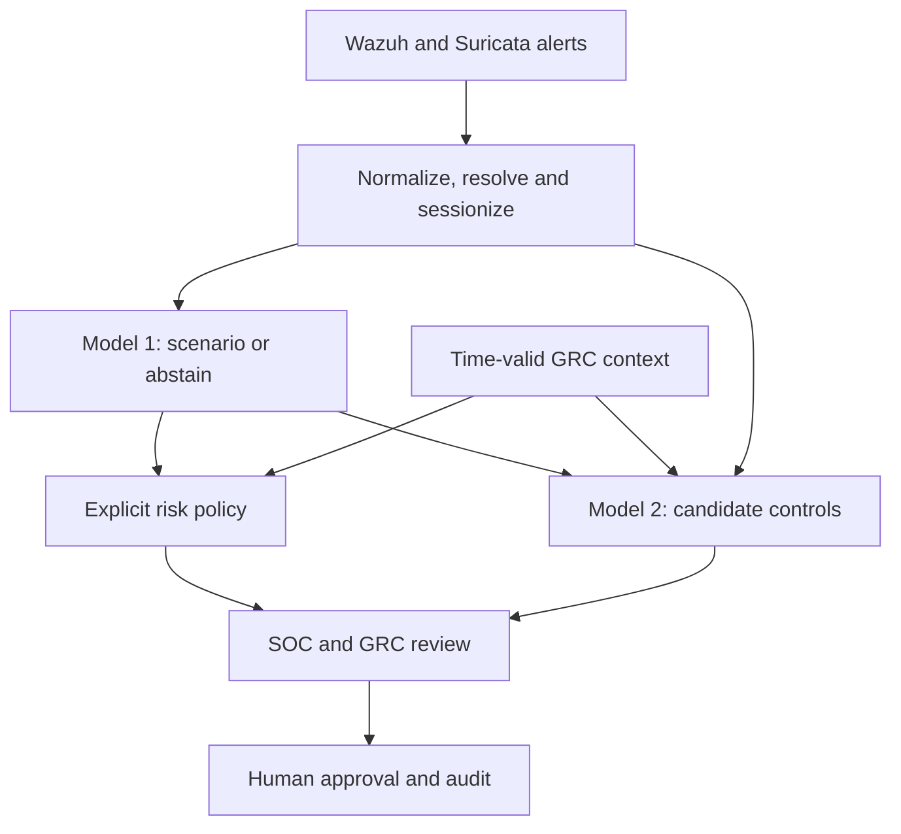

# IRIS models: complete technical and practical explanation

Version 1.1.0 | 25 October 2026

## Three-source workflow added in this version

The package now directly accepts three operational datasets: asset inventory, risk register and SIEM alerts. `prepare-three` validates them, performs exact point-in-time joins and produces `unified_events.jsonl` plus the derived `model_sessions.jsonl`. `train-three` and `predict-three` use this same preparation path. Read [the complete three-input guide](THREE_INPUTS_GUIDE.md) for schemas, commands, sample counts and temporal/join safeguards.

The three operational sources are sufficient to run inference when they contain the required fields. Supervised training additionally needs separate scenario/control targets. The sample label sidecar is offline-only and synthetic; it never enters runtime feature preparation. Version 1.1 also accepts explicit `operational` provenance for real reviewed SIEM data, in addition to `cyber_range` and `synthetic`. That does not establish production validation.

The remaining sections explain the model layer and the earlier standalone/raw-range interfaces. New integration behavior is documented separately so the feature and learning explanations remain applicable.

## 1. What this code achieves

IRIS is middleware between SOC/SIEM evidence and GRC business context. It is not a replacement SIEM, a vulnerability scanner, an autonomous response agent or the official risk register.

This deliverable implements the learning layer:

1. Identify a supported activity scenario from an observed security session.
2. Recommend zero or more candidate controls using telemetry, predicted scenario and pre-existing GRC context.
3. Report uncertainty, evidence, model status and fallback source.
4. Leave risk policy, human approvals and official changes to the existing IRIS engine.

It includes runnable Python, a synthetic demo, saved demo artifacts, tests and adapters. It does **not** include a model validated on actual GNS3 campaigns: those exports and reviewed labels are still required.

### Architecture



The reverse direction remains important: a GRC criticality/risk/control change should cause the engine to re-enrich affected sessions and re-run policy/recommendations. The classifier does not need to be retrained for every criticality update. This package does not create the reverse-trigger service.

## 2. Why this is supervised tabular learning

The unit being classified is a security **session**, not a photograph, a single raw log line, or an entire run indiscriminately. We turn related telemetry into counts, rates and categories. That is tabular data.

Supervised learning means that training examples have independently reviewed target answers. At inference time, those answers are not available.

- **Model 1:** multiclass classification. Each reviewed session has one target class.
- **Model 2:** multi-label classification. A reviewed session can have several appropriate controls, or none.
- **Risk policy:** deterministic rules, not a third learned model in this release.

ANNs, CNNs and clustering are not required for this first implementation. A CNN's spatial assumptions are not an obvious match for these aggregate features. Deep networks add capacity that a small controlled campaign may not justify. Clustering could support exploration later, but it cannot substitute for verified scenario/control labels.

The earlier engine selected Logistic Regression on a synthetic dataset. This package does not assume that choice will win on new data: it compares three candidates and selects the simplest candidate within 0.01 macro-F1 of the best selection score. The preference order is Logistic Regression, Random Forest, then Histogram Gradient Boosting.

In the included synthetic software run, Random Forest was selected. This is not evidence that Random Forest is best for actual campaigns.

## 3. The exact supported labels

| Range activity | Model 1 target | Interpretation |
| --- | --- | --- |
| `ssh_bruteforce` | `credential_access` | Observed credential-access pattern |
| `network_scan` | `reconnaissance` | Observed reconnaissance pattern |
| Reviewed benign look-alikes | `benign` | Reviewed benign behavior within the defined experiment |

Template names belong only in offline annotation metadata. They do not enter the model's feature vector.

The real range described in the project currently supplies SSH guessing, TCP scanning and login-mistype controls. It does not establish validated detection for SQL injection, malware, privilege abuse or denial of service. Those require new supported classes, reviewed examples, feature review and new validation.

`ABSTAINED` is a decision status, not an attack class. It means the system is not issuing a usable class assessment. It is not a declaration of safety.

A closed-set classifier can be confidently wrong about an unseen attack that resembles a known class. Confidence thresholds and category checks are not a general unknown-attack detector.

Technical behavior is not the same as malicious intent. An authorized scan can look identical to hostile reconnaissance, and repeated failures do not prove account compromise. If authorization is essential to the benign/attack distinction, supply an independently validated runtime-available authorization signal through a deliberately reviewed contract or downstream policy. Never substitute the hidden template label. The included synthetic test exposes this ambiguity and fails its benign-FPR gate; see `VERIFICATION.md`.

## 4. Model 1 inputs: all 16 fields

Two categorical fields and fourteen numeric fields are allowed. Extra feature keys are rejected, not silently learned.

| Feature | Meaning |
| --- | --- |
| `event_family` | Normalized family such as `authentication` or `network` |
| `primary_protocol` | Most frequent observed protocol, e.g. `SSH` or `TCP` |
| `event_count` | Number of deduplicated observed events in the session |
| `duration_seconds` | Last event time minus first event time |
| `max_rule_level` | Highest normalized severity; Wazuh scale bounded to 0..16 |
| `mean_rule_level` | Mean normalized event severity |
| `distinct_rules` | Number of distinct observed rule/signature identifiers |
| `distinct_sources` | Count of distinct observed source addresses, not their literal values |
| `distinct_accounts` | Count of distinct observed account strings, not usernames as predictors |
| `failed_count` | Authentication-failure outcomes |
| `success_count` | Authentication-success outcomes |
| `failure_ratio` | Failures / (failures + successes); zero if neither outcome is observed |
| `success_after_failures` | 1 when a success follows a failure, otherwise 0 |
| `max_events_in_10s` | Largest event count in any rolling ten-second window |
| `external_source_fraction` | Fraction of events with a non-private, non-loopback/link-local source |
| `event_rate_per_minute` | `event_count * 60 / max(duration_seconds, 1)` |

Missing, non-finite, negative and inconsistent values are rejected. Counts must be integers, outcome counts cannot exceed event count, and ratios/rates must match their underlying counts.

The minimum one-second duration in the rate avoids division by zero. A single event therefore has a rate of 60/minute. Do not interpret that derived rate as a sustained throughput measurement.

Literal IPs, hostnames, identities, run IDs, campaign IDs, template names, ground truth, risk levels and recommended control IDs are not Model 1 inputs. Metadata can still retain evidence references and grouping IDs outside the feature vector.

Asset criticality is intentionally not a Model 1 feature. Changing business importance should change risk prioritization, not turn identical telemetry from benign into an attack.

## 5. Where raw telemetry becomes a session

The CyberRangeV1 adapter reads these runtime files:

```text
campaign-export/
  campaign_manifest.json
  runs/run-.../
    topology.json
    identity_data.json
    wazuh_stuff/alerts.jsonl
    suricata_stuff/eve.json
    quality/sensor_health.json
```

It deliberately does not parse `scenarios/scenario.json`, `activity_ground_truth.jsonl` or a `truth/` plane. Hash verification also skips those label/scenario files. The manifest must cover the required runtime files.

Processing is:

1. Validate file integrity against the campaign manifest. A checksum does not authenticate who produced the campaign.
2. Parse timezone-aware timestamps into UTC; no timestamp is invented from a scenario label.
3. Normalize Wazuh alerts and Suricata **alert** records. EVE flow/DNS/statistics records are not features in this schema.
4. For a Suricata alert, provisionally map severity `1 -> 10`, `2 -> 7`, `3 -> 4`. This remains an IRIS integration policy requiring real-output validation.
5. Deduplicate identical Wazuh-wrapped/direct EVE alerts using flow/signature/time/endpoints/ports. Missing or reformatted wrapper fields can defeat exact deduplication; that needs inspection against a real export.
6. Resolve the affected asset by exact destination IP, or by reporting-agent hostname when destination IP is absent. Ambiguous/missing matches go to quarantine. The adapter does not use the truth target to resolve an event.
7. Group by affected asset, account, source and event family. Split when the gap between consecutive events exceeds the window, normally 60 seconds.
8. Calculate the sixteen allowed features and preserve raw references.

The 60 seconds is an **inactivity gap**, not a maximum session duration. Repeated events less than 60 seconds apart can keep a session open longer. This mirrors the original engine's session grouping; a hard maximum lifetime would need an explicit new contract.

Try 30 and 120 seconds with `--window` in separate experiments. A session ID includes the window. Do not reuse old session annotations after changing the window.

Accounts use exact identity-file matching. Unknown observed accounts are marked `UNRESOLVED`. No fuzzy username/person inference is performed.

All expected agents and required health endpoints must be healthy. Missing health, collection/action errors, empty sensor files, malformed records or missing hashes prevent the resulting data from being treated as healthy training evidence. A quiet live feed must not be inferred healthy or unhealthy from silence; a live connector needs explicit heartbeat/collection status.

**Not field-validated:** the adapter is tested with local representative Wazuh/EVE fixtures, not an executed GNS3 campaign. Real export differences may require explicit field mappings and a version bump.

## 6. Observations and labels are separate

An observed session looks like the included `examples/synthetic_demo/sample_session.json`. Real observations must use `data_provenance: "cyber_range"`; generated fixtures use `"synthetic"` and require `--synthetic` during training.

Relevant observation metadata:

```json
{
  "session_id": "SES-from-the-extractor",
  "run_id": "run-0001-ssh_bruteforce",
  "campaign_id": "campaign-20261024-01",
  "data_provenance": "cyber_range",
  "aggregation_schema": "cyberrange-session-v1-window60",
  "sensor_healthy": true,
  "features": {"all_16_allowed_fields": "see sample_session.json"},
  "context": null,
  "evidence_refs": ["campaign/run/wazuh_stuff/alerts.jsonl#L42"]
}
```

The abbreviated `features` object above is explanatory, not executable. Use the complete sample as the schema reference; never relabel the synthetic sample as real evidence.

A separate reviewer-owned JSONL file supplies one annotation per observed session:

```json
{
  "session_id": "SES-from-the-extractor",
  "run_id": "run-0001-ssh_bruteforce",
  "campaign_id": "campaign-20261024-01",
  "template_group": "ssh-password-guessing-variant-A",
  "scenario_class": "credential_access",
  "label_verified": true,
  "reviewer": "actual_scenario_reviewer",
  "recommended_control_ids": ["SC005", "SC007"],
  "controls_reviewed": true,
  "control_reviewer": "actual_control_reviewer"
}
```

Those control IDs are a schema example, not a claim that they apply universally. A domain reviewer must check applicability, authorization, existing safeguards and operational constraints.

An attack run can contain background housekeeping, successful administration or unrelated sessions. Therefore the importer does not label every session with the run's attack class. Use evidence/time links to review the actual session. This is a major protection against misleading labels.

Labels without verification/reviewer, bad sensor health and malformed feature rows are quarantined. Duplicate session/review IDs and orphan reviews are errors. Training reports record accepted counts, quarantine reasons, duplicate feature-vector counts and source hashes.

Metadata statements and reviewer names are local assertions, not cryptographic proof. The project still needs a real review workflow and trusted evidence custody.

## 7. Model 1 mathematics and fitting

### Preprocessing

Categorical variables are one-hot encoded: each known category gets a binary column. Numeric variables are standardized using training-set means and scales. The preprocessing is inside the fitted pipeline, so selection/calibration/threshold/test data cannot change the training statistics.

### Candidate A: Logistic Regression

For each class, the classifier learns a weighted score:

`z_class = intercept_class + sum(weight_class,j * transformed_feature_j)`

The multiclass model converts these scores into relative class probabilities using softmax. Training minimizes classification loss with regularization. Balanced class weights reduce the dominance of a more frequent class.

Despite the name, this is a classifier, not a prediction of a continuous risk score.

### Candidate B: Random Forest

The model fits an ensemble of decision trees using bootstrap samples and randomized feature consideration. Trees can capture nonlinear combinations such as many failures plus a high failure ratio without specifying every interaction manually. Depth/leaf-size constraints reduce overfitting. The implementation uses 160 trees, maximum depth 12 and minimum leaf size 3.

### Candidate C: Histogram Gradient Boosting

The model builds a sequence of trees that improve on earlier classification errors. Histogram binning makes numeric fitting efficient. The implementation uses 100 iterations, at most 15 leaves per tree and L2 regularization.

### Calibration and abstention

After selecting the candidate, refit it on fit + selection groups. Freeze that fitted pipeline and calibrate its probability outputs using a separate calibration split with sigmoid calibration.

Choose the confidence threshold using only the separate threshold split. If the highest class score is below that threshold, abstain. Calibration on a small or unrepresentative set is limited; a reported score is not a guarantee about an individual case.

For a Logistic Regression winner, explanations show feature contributions to the **base classifier logit**, not to the final calibrated probability. For Random Forest/boosting, the package reports observed evidence and explicitly does not claim a faithful local feature attribution. A validated explanation method such as permutation analysis or SHAP would be a separate enhancement.

## 8. Grouped evaluation: the most important correctness rule

Randomly splitting log rows is misleading when many rows come from the same activity or campaign. Those rows are not independent.

The package assigns each whole group to exactly one of five roles:

| Data role | Purpose | Approximate group share |
| --- | --- | --- |
| Fit | Fit candidate models and preprocessing | Remaining groups, usually about 50% |
| Selection | Compare candidates | 15% |
| Calibration | Fit probability calibration only | 10% |
| Threshold | Choose scenario/control thresholds | 10% |
| Test | Final untouched evaluation | 15% |

Shares round to whole groups and each role gets at least one group, so small datasets can differ substantially. With twenty balanced campaigns, there are ten fit, three selection, two calibration, two threshold and three test campaigns.

The default independence unit is `campaign_id`. `template_group` can test unseen behavioral families/variants. `run_id` keeps physical runs separate but does not establish generalization across campaigns/templates, so it cannot qualify for release.

At least five independent groups are necessary, and all three classes must appear in every role. A single campaign with 75 runs is not five independent campaigns. If a split lacks a class, collect a better planned dataset rather than searching for a lucky test seed.

All sessions from one physical run are checked to remain together. Duplicate feature vectors are reported for investigation: exact duplicates are not automatically evidence of contamination when discrete telemetry can genuinely repeat. Near-duplicates, common templates, asset/time leakage and observer annotation bias still require review.

The test split must be used once for the declared experiment. Do not repeatedly tune models, thresholds or seeds against test results. Collect a new independent holdout for later revisions.

## 9. Metrics, uncertainty and release gates

Model 1 reports:

- **Precision:** of sessions assigned a class, how many truly had that class?
- **Recall:** of all sessions truly in a class, how many received the correct accepted classification?
- **F1:** harmonic mean `2 * precision * recall / (precision + recall)`.
- **Macro-F1:** mean F1 across the three fixed supported classes.
- **Coverage:** fraction of all sessions not abstained.
- **Benign false-positive rate:** benign sessions accepted as an attack / all benign sessions.
- **Confusion matrix:** true class against emitted class, including an abstention column.

Abstained attacks count as missed true classes when computing recall/F1. Evaluating only accepted rows can hide missed attacks; this implementation does not use that shortcut. FPR excludes abstentions, so always read it with coverage and recall.

A Wilson 95% interval is included for the benign false-positive rate. Zero observed false positives in a tiny test is not proof that the underlying false-positive rate is zero or below 5%.

The inherited Part C operational thresholds are:

| Model 1 requirement | Threshold |
| --- | --- |
| Macro-F1 | At least 0.80 |
| Recall for each attack class | At least 0.75 |
| Benign FPR | No more than 0.05 |
| Coverage | At least 0.80 |
| Improvement over frozen rules on the same test | At least 0.05 absolute macro-F1 |

Additional safeguards in this package require real reviewed cyber-range provenance, a campaign/template holdout and at least ten test sessions per class. The ten-session rule is a **proposed conservative engineering minimum**, not a previously agreed project requirement or sufficient statistical assurance. Agree it with the project owner. It can require more than the 25-runs-per-class intake minimum.

The threshold search checks operational F1/recall/FPR/coverage on validation data. The final release gate applies the actual test results and provenance checks. If no threshold can satisfy the checks, the model remains shadow-only; there is no silent threshold relaxation.

This package's rule baseline is frozen before evaluation. For authentication, at least 12 failures and a failure ratio of at least 0.75 indicate credential access; at most three failures followed by a success can indicate the defined benign look-alike. For network events, at least 15 events and four distinct rules indicate reconnaissance. Other cases abstain. These rules are explicit prototype heuristics, not universal attack truth.

## 10. Model 2: learning several controls

One incident can call for MFA, monitoring and an escalation review simultaneously. Therefore Model 2 is multi-label rather than a single mutually exclusive class.

### Inputs

It uses the sixteen telemetry fields plus:

| Additional input | Source |
| --- | --- |
| `predicted_scenario` | Model 1 prediction, never hidden scenario truth |
| `asset_type` | Current validated asset context |
| `asset_criticality` | Time-valid GRC value, 1..5 |
| `current_likelihood` | Existing risk-register likelihood before this recommendation, 1..5 |
| `impact` | Existing risk context, 1..5 |
| `previous_similar_24h` | Previously observed similar sessions, not future events |

The extractor cannot manufacture this GRC context. `context: null` is allowed for Model 1. It excludes the session from Model 2 fitting until the real context is available.

### Targets

Targets are reviewer-approved lists of catalogue IDs. Attack labels alone do not create control-recommendation labels. A catalogue of controls is the output vocabulary, not a training dataset.

The bundled catalogue reuses the project's thirty internal control IDs. Framework references in that catalogue are inherited annotations, not independently validated statements of compliance.

### Binary relevance

The package fits one Logistic Regression classifier for each sufficiently supported control. For control `c`, it learns:

`membership_score_c = sigmoid(intercept_c + weights_c * transformed_context)`

This is supervised binary relevance, conceptually similar to one-vs-rest multi-label learning. Controls with fewer than five positive or five negative fit examples are unsupported; constant outputs are not disguised as learned expertise.

Per-control selection thresholds are chosen only on the threshold split, maximizing F1 among candidates with validation precision of at least 0.80. A label with no satisfactory threshold is suppressed.

These scores are **uncalibrated label-membership scores**. A score of 0.8 does not mean the control is 80% effective or will reduce risk by 80%.

### Avoiding oracle scenarios

Using true attack classes as Model 2 inputs during evaluation would give it information unavailable at runtime. Instead:

1. For Model 2 fit examples, generate scenario inputs using grouped out-of-fold Model 1 candidates. Every row's scenario prediction comes from a model that did not fit that row's group.
2. For threshold/test examples, use the frozen fitted/calibrated Model 1.
3. Never pass `scenario_class` directly as a Model 2 feature.

The cross-fitted classifiers are not calibrated inside each fold in this first version, so their score distribution can differ from final calibrated predictions. They apply the selected threshold to approximate abstention. The untouched end-to-end test exposes some of this mismatch, but more data and nested cross-fitted calibration would improve the design.

### Evaluation and proposed gate

Metrics include micro precision/recall/F1, macro-F1 across the full catalogue, exact-set accuracy, Hamming loss and per-control support/precision/recall. Full-catalogue macro-F1 is explicitly low when many controls have no positive examples; do not replace it with a misleading claim of complete catalogue coverage.

The proposed control gate requires at least one active supported label, micro precision/F1 at least 0.80, performance no worse than a training-only scenario-frequency baseline, at least twenty fit positives and twenty negatives for every active label, and five held-out positives per active label. Real evidence and Model 1's release eligibility are also required. These are engineering minimums for project-owner review, not a compliance standard or validated safety guarantee. Per-control error tradeoffs and outcome-based efficacy remain unproven.

### Post-model policy

The engine separately checks current control state:

| Current state | Proposed review action |
| --- | --- |
| Missing | Consider installation, subject to approval |
| Partial | Extend coverage |
| Implemented | Verify coverage/effectiveness |
| Unknown, compensating, exception or not assessed | Review |
| Active approved exception | Review exception/compensating controls first |

If learned recommendations are unavailable or none exceeds its threshold, the explicit catalogue fallback is labelled as such. Fallback items have `model_score: null`, not a fabricated probability. In the older engine's required float score field, the bridge uses 0 with a clearly identified fallback source.

## 11. Safe runtime behavior

Three modes exist:

| Mode | Primary output | ML output |
| --- | --- | --- |
| `rules` | Frozen rules/catalogue or abstention | Not inferred |
| `shadow` (default) | Frozen rules/catalogue or abstention | Separate `shadow_candidate` for evaluation |
| `advisory` | Released Model 1/Model 2 only where independently approved; otherwise fallback | Still advisory, never autonomous |

Sensor health must explicitly be `true`. Otherwise no attack/benign assessment or control recommendation is issued. Missing model files, incompatible versions, checksums or catalogue revisions disable ML and expose a warning.

Runtime also checks `aggregation_schema`. Identical column names do not make Wazuh-only and Wazuh-plus-Suricata sessions equivalent. Training and inference must use the same normalizer/sessionizer/window contract. A mismatch disables ML rather than guessing.

Unseen categorical feature values cause ML abstention. Numeric out-of-training-range values produce visible extrapolation warnings; they are not proof of novelty and do not automatically block every extreme attack. Drift monitoring is still required.

Model-level release and per-incident human approval are different:

1. A project/model reviewer releases a validated model for advisory use.
2. An authorized operational/risk reviewer decides whether to accept each specific recommendation or risk-review proposal.

No package function executes a firewall command, isolates a host, locks an account, sends to an external GRC endpoint or writes an official risk register. `release.json` is a local prototype approval record, not enterprise authentication or a tamper-resistant approval system.

## 12. How to run everything

From the extracted project directory, install pinned requirements in a virtual environment. The README gives Windows and Linux/macOS commands.

### A. Working synthetic software demo

```bash
python -m iris_models demo --out my_first_demo
```

This creates 180 synthetic sessions (60 per class) across twenty artificial campaigns, fits both components where supported, saves reports and produces a shadow prediction. These artificial campaign IDs are not evidence of independent real-world campaigns.

### B. Tests

```bash
python -m unittest discover -s tests -v
```

### C. Inspect a prediction

```bash
python -m iris_models predict --session my_first_demo/sample_session.json --models my_first_demo/models --out my_first_demo/new_prediction.json
```

Relevant output keys are `soc_assessment`, `grc_control_review`, `shadow_candidate`, evidence, warnings and explicit approval/no-execution flags. In shadow mode, do not accidentally display the candidate as the accepted primary answer.

### D. Export and review real data

```bash
python -m iris_models extract-range --campaign /path/to/campaign-export --out data/campaign_sessions.jsonl
```

Repeat for independently executed campaigns. Combine their observed-session JSONL files while preserving unique session IDs and campaign IDs. Join time-valid GRC context; independently review scenario/control targets into a separate JSONL file. No observation/review combination or GRC join is done automatically in this release because choosing the correct risk record/context requires project-specific judgement.

### E. Train a real experiment

```bash
python -m iris_models train --sessions data/real_sessions.jsonl --reviews data/real_reviews.jsonl --group-by campaign_id --out experiments/real_v1
```

Use a new output directory for every declared experiment. Use `--synthetic` only for explicitly generated data. `--group-by run_id` is available for development but blocks release.

### F. Review and release

```bash
python -m iris_models promote model1 --models experiments/real_v1 --reviewer actual_model_owner
python -m iris_models promote model2 --models experiments/real_v1 --reviewer actual_control_reviewer
python -m iris_models predict --session data/new_session.json --models experiments/real_v1 --mode advisory
```

These commands fail when the evidence/metric gate fails. Synthetic provenance can never pass the real-evidence check.

## 13. Integrating the existing v0.3 engine

The package is a separate Python module, not a replacement `joblib` file for the old loader. Do not rename `models.joblib` over the old scenario/control artifact: the formats differ.

With this package importable in the existing engine environment:

```python
from pathlib import Path
from iris_models.runtime import ModelService
from iris_models.bridge_v03 import ScenarioAssessorV1, ControlRecommenderV1

service = ModelService(
    Path("experiments/engine_sessions_v1"),
    Path("/path/to/IRIS_Models_v2/iris_models/data/control_catalog.csv"),
)

# Implement this from the engine's validated source-health snapshot/heartbeat.
# Do not replace it with an unconditional True in a real experiment.
def healthy(context):
    return validated_source_health_for(context.session.run_id) is True

# 'engine' is an already initialized IRISEngine from the original project.
engine.assessor = ScenarioAssessorV1(service, health_check=healthy, mode="shadow")
engine.recommender = ControlRecommenderV1(service, health_check=healthy, mode="shadow")
```

`validated_source_health_for` is intentionally an integration hook, not a supplied function. Connect it to the existing validated quality/health data. The bridge returns the engine's `Assessment` and `ControlRecommendation` schema objects when the original engine and its dependencies are installed.

For training compatible with that original Wazuh sessionizer, export observed rows through `observation_from_context`, add actual campaign/provenance metadata, reviewed labels and real health status, and train that dataset. The bridge declares `iris-v03-wazuh-session-v1`. The native raw-range adapter declares `cyberrange-session-v1-window60`. Models trained through one path will not silently activate on the other.

The integration bridge has been tested against representative schema-shaped local objects, and its outputs were validated using the actual supplied v0.3 `Assessment` and `ControlRecommendation` schema classes. A full execution against the original engine's API/dashboard dependencies and actual campaign inputs remains an integration task. This package does not claim to have completed that external integration.

Risk likelihood, impact, risk appetite, priority matrices, the six-hour fade and repeat discounts remain in the original explicit risk policy. They are not learned here. Real repeated-attack timing is still needed to validate those provisional policy numbers.

## 14. Source-code map

| File | Responsibility |
| --- | --- |
| `iris_models/contracts.py` | Allowed features, validation, JSON helpers and frozen rule baseline |
| `iris_models/telemetry.py` | Raw range normalization, deduplication, exact matching, health/integrity and sessions |
| `iris_models/dataset.py` | Offline review join, quarantine, independent-run count and grouped split |
| `iris_models/training.py` | Candidate fitting, calibration, thresholding, metrics, cross-fit controls and gates |
| `iris_models/runtime.py` | Trusted artifact loading, release checks, inference, explanations and control policy |
| `iris_models/bridge_v03.py` | Optional adapters to the existing engine's assessment/recommender interfaces |
| `iris_models/demo.py` | Artificial fixture generator, explicitly marked synthetic |
| `iris_models/__main__.py` | Commands: demo, train, predict, extract-range, promote |
| `iris_models/data/control_catalog.csv` | Inherited thirty-control vocabulary and descriptions |
| `tests/test_models.py` | Unit and end-to-end checks |
| `examples/synthetic_demo/` | Reproducible software-demo inputs, reports, model and prediction |

Each experiment produces `models.joblib`, `metadata.json`, `threshold_search.json` and `split_manifest.json`. Metadata includes input hashes, class/control support, algorithm selection, metrics, gates, schema, version and model checksum. A reviewer-approved release additionally creates `release.json`.

## 15. What is still needed from the cyber-range/GRC team

1. One complete real export and the person who can execute additional independent campaigns.
2. At least 25 runs per supported class, including sufficiently varied benign look-alikes; more runs/independent groups are needed for credible holdout evidence.
3. Vary attackers, targets, accounts, schedules and behavioral templates. Removing literal IP features alone does not remove all experimental shortcuts.
4. Full monitored-agent coverage, actual EVE alerts, reliable UTC timing, explicit source health and manifest hashes.
5. Reviewed session-to-activity evidence links, not blanket run labels.
6. Separately reviewed control targets and time-valid asset/risk/control/exception context.
7. Repeated same-asset attacks and real incident timings to validate the existing risk fade/discount/session policy.

The shipped range defaults to ten normal runs, while the agreed data decision calls for at least twenty-five benign runs. Set its campaign's `--normal-runs 25` or higher and obtain varied benign scenarios. Twenty-five copies of the same easy login-mistype pattern do not validate all benign look-alikes.

## 16. Security and evidence limits

- Only load trusted local/verified artifacts. Pickle/joblib can execute code.
- Pin versions; the loader rejects a different scikit-learn version rather than claiming cross-version compatibility.
- Hashes provide integrity relative to a trusted manifest, not identity, authorization or provenance authentication.
- The local release file is not access control; use authenticated, audited approval/storage in a production design.
- The adapter is offline only. Live SIEM collection, retry/checkpoint handling, source heartbeat, TLS and GRC delivery acknowledgements remain separate work.
- No automated attacker action or campaign execution is included in this package.
- No evidence of control efficacy, causal risk reduction, production performance or general unknown-attack detection is claimed.

## 17. Primary technical references

The implementation was checked against official scikit-learn documentation. The installed/tested API version is pinned to 1.8.0 even when the website's `stable` documentation advances.

- [Common pitfalls and data leakage](https://scikit-learn.org/1.8/common_pitfalls.html)
- [Grouped cross-validation](https://scikit-learn.org/1.8/modules/cross_validation.html)
- [Probability calibration and disjoint fitting/calibration data](https://scikit-learn.org/1.8/modules/calibration.html)
- [Multiclass and multi-label strategies](https://scikit-learn.org/1.8/modules/multiclass.html)
- [Model persistence, security and version compatibility](https://scikit-learn.org/1.8/model_persistence.html)

Project grounding: the supplied cyber-range requirement sheet; the existing IRIS v0.3 README, model-status/evaluation documents and source; the CyberRange GNS3 bundle's export code/layout; and the previously recorded Part C/D decisions. The guide distinguishes inherited decisions from the additional proposed engineering safeguards above.
