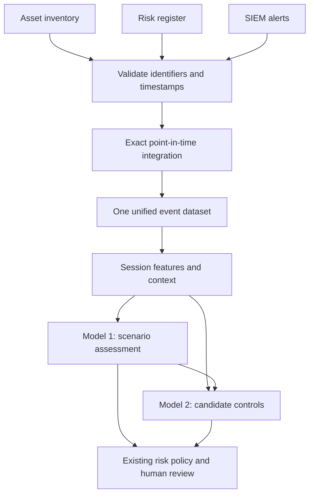

# IRIS: three input datasets, one integrated model input

Version 1.1.0 | 25 October 2026

## What is ready

The package now accepts the three operational datasets requested:

1. Asset inventory.
2. Risk register.
3. SIEM alerts.

It constructs one unified, evidence-preserving event dataset before session feature engineering and ML. The same function performs integration during training and inference, with a versioned sessionization contract. There is no separate training-only join that could silently differ from runtime.

Minimal validation must happen **before** joining: an empty ID, malformed timestamp or duplicate key can otherwise attach incorrect context or multiply rows. Later feature processing still belongs in the train-fitted ML pipeline.



This is tested batch integration for the declared schemas, not a promise of perfection, compatibility with every vendor export, or unlimited production scalability.

## The three supplied samples

| File | Contents | Sample size |
| --- | --- | --- |
| `asset_inventory.json` | Asset identifiers, IPs, hostname, type, business criticality, owner, zone and version validity | 60 distinct assets, 120 historical snapshots |
| `risk_register.json` | Asset-linked risk IDs/categories, likelihood, impact, control states, active exceptions and version validity | 120 distinct risks, 240 historical snapshots |
| `siem_alerts.jsonl` | Individual timestamped alerts with stable IDs, affected-asset clues, severity, outcomes, protocol and source-health status | 26,086 alert rows |

All values are artificial. Names refer to fictional assets/roles; no actual hospital, employee or organization is represented. The examples use JSON/JSONL so nested risk/control context and event evidence are not flattened away.

The samples support 900 synthetic labeled sessions across sixty artificial campaign IDs:

| Session target | Labeled sessions/runs |
| --- | --- |
| Benign look-alikes | 300 |
| Credential access | 300 |
| Reconnaissance | 300 |

These counts are sufficient to execute this package's fitting, candidate comparison, calibration, threshold selection and grouped software evaluation. Artificial campaign IDs are not independent real experiments. No generated sample size can prove real-world accuracy or replace real reviewed evidence.

There are also deliberate quality cases: twelve exact duplicate alert rows, two alerts referencing an unknown asset, and one malformed timestamp. The report identifies them; they do not become mislabeled training sessions.

## Operational input 1: asset inventory

Root object:

```json
{
  "schema_version": "iris-asset-inventory-v1",
  "data_provenance": "synthetic",
  "records": [
    {
      "asset_id": "AST-001",
      "asset_version_id": "AST-001-V1",
      "hostname": "server-001",
      "asset_type": "server",
      "ip_addresses": ["10.44.0.11"],
      "criticality": 4,
      "zone": "service_zone",
      "owner": "Infrastructure",
      "valid_from": "2026-07-01T00:00:00+00:00",
      "valid_to": "2026-08-01T00:00:00+00:00",
      "recorded_at": "2026-07-01T00:00:00+00:00"
    }
  ]
}
```

The row above illustrates the schema, not necessarily the generated first row. Read the actual file for its values.

- `asset_id` is the stable entity key.
- `asset_version_id` uniquely identifies one historical snapshot.
- `criticality` is a real pre-existing business value on the project's 1..5 scale. The importer never invents it from an IP or hostname.
- `valid_from` is inclusive; `valid_to` is exclusive. `null` means open-ended.
- `recorded_at` is when that snapshot became known to the system.
- Every timestamp must include a timezone and is normalized to UTC.

Each asset's validity intervals must not overlap. Gaps remain missing context, not a request to fill from a future record. IP changes are supported when historical records identify the address valid at the event time.

## Operational input 2: risk register

Root object uses `schema_version: "iris-risk-register-v1"`, explicit provenance and a `records` array. Each record contains:

| Field | Meaning |
| --- | --- |
| `risk_id` | Stable registered risk identifier |
| `risk_version_id` | Unique historical snapshot identifier |
| `asset_id` | Foreign key to an inventory asset |
| `risk_category` | Existing organizational risk category |
| `likelihood`, `impact` | Pre-decision values on the project's 1..5 scale |
| `control_states` | Optional control-ID-to-state mapping for this risk's asset context |
| `active_exception_control_ids` | Optional currently approved exception IDs, represented by control ID |
| `valid_from`, `valid_to`, `recorded_at` | Same point-in-time semantics as inventory |

For the declared export contract, control/exception state is already the approved state for that snapshot. A live integration must source those values from the authoritative GRC workflow. This importer does not invent a control-state assessment or decide whether an exception is legally/operationally valid.

Missing control-state records stay unknown and produce review actions. The bundled control catalogue remains a fixed model resource; it is not a fourth changing operational dataset.

Asset-level risk links are supported in this version. Service-level, process-level or many-asset risk relationships require an explicit relationship mapping rather than a guessed join or first-match lookup.

### Multiple risks on one asset

An asset can have several registered risks. The importer keeps them in a nested `risks` list on the same unified alert. It does not duplicate the alert for every risk.

Model 2 currently needs one scalar likelihood/impact context pair. The declared policy chooses the available risk with the largest **pre-existing likelihood times impact**, breaking ties by risk ID. Both values come from that same risk record; it never combines one risk's likelihood with another's impact. The chosen ID/version/policy are exposed in the session context.

This representative context is not a claim that the highest prior risk is the risk caused by the alert. All risk records remain available to the existing engine's scenario-to-risk mapping after Model 1. No official risk score, likelihood or risk record is changed by this selection policy.

## Operational input 3: SIEM alerts

The sample is newline-delimited JSON: one object per alert. The canonical format has:

```json
{
  "event_id": "EVT-000001-001",
  "timestamp": "2026-07-02T09:00:00+00:00",
  "asset_id": "AST-001",
  "destination_ip": "10.44.0.11",
  "agent_name": "server-001",
  "source_ip": "10.88.0.42",
  "account": "alice",
  "event_family": "authentication",
  "protocol": "SSH",
  "rule_id": "5710",
  "rule_level": 7,
  "outcome": "failed",
  "sensor_healthy": true,
  "campaign_id": "SYN-CAMPAIGN-001",
  "run_id": "RUN-000001",
  "data_provenance": "synthetic"
}
```

The example illustrates fields, not the actual first generated event. Real Wazuh-shaped alerts and EVE alert records can also use the existing normalizers, but must provide stable event IDs, explicit provenance and source-health evidence. Other vendor exports need a declared mapping into this canonical contract. Native non-alert EVE records are ignored because the current feature schema models alerts, not flow/statistics tables.

In real data, `sensor_healthy` must come from a trusted collector/heartbeat assessment. Do not mark it true simply because one alert exists. Quiet periods and delayed delivery require explicit live-source health handling outside this offline package.

Campaign/run IDs are offline grouping metadata, never ML predictors. Runtime batches can omit them, but training requires meaningful independent campaign/run/incident-cohort identifiers and reviewed labels; default runtime IDs are not independent training groups.

### Exact asset matching

1. If a trustworthy `asset_id` is supplied, require a matching inventory snapshot valid and known at event time.
2. If both asset ID and destination IP are supplied, require them to agree.
3. Without asset ID, try a unique destination-IP match at event time.
4. Without destination IP, try a unique reporting-agent hostname match at event time.
5. Otherwise retain the alert as unresolved for review.

The attacker/source IP is never used as a fallback victim lookup. Null keys do not match other null keys. Hostname matching is case-normalized exact matching, not fuzzy guessing. NAT, aliases, observation-only sensor hostnames and vendor-specific identity semantics need explicit source mapping, not a relaxation that silently attaches the wrong asset.

Deduplication uses stable globally scoped SIEM event IDs. Identical repeats collapse. If the same ID has conflicting content, all versions are excluded and reported. Correlating the same real event under different independent vendor IDs is not solved automatically by this path; configure a verified upstream correlation key when needed.

## Join order and temporal protection

The processing sequence is:

1. Validate schemas, IDs, types, timezone-aware timestamps and version histories independently.
2. Normalize canonical SIEM fields and deduplicate stable event IDs.
3. Resolve the affected inventory asset using explicit exact keys.
4. Attach every asset-linked risk snapshot valid and known at that event time.
5. Write one `unified_events.jsonl` row per accepted deduplicated alert, including unresolved rows with visible status.
6. Group matched alerts into sessions using asset/account/source/event-family, campaign/run and the declared inactivity window.
7. Split a session when its inventory/risk snapshot versions change, preventing mixed-context sessions.
8. Build Model 1's sixteen allowlisted features and Model 2's pre-existing GRC context.
9. Run the existing train-fitted preprocessing, model selection, calibration, abstention, control-policy and human-review logic.

For each snapshot, the join requires:

`valid_from <= event_timestamp < valid_to` (unless open-ended), and `recorded_at <= event_timestamp`.

A backdated record entered later cannot leak backward merely because its effective date is old. Missing/ambiguous inventory context is retained in the unified dataset but not guessed into an ML session. Missing risk context does not erase a technically valid session: Model 1 can still be trained, while Model 2 is excluded until its GRC prerequisites exist.

The rolling `previous_similar_24h` context counts only earlier **completed** sessions on the same asset with the same observed event family/protocol. It does not use hidden true scenario labels, overlapping/incomplete sessions or future sessions. This is explicitly observed-category similarity, not the older engine's predicted-scenario history definition. The aggregation schema prevents those contracts from being mixed silently.

This is a batch/event-time reconstruction. A production delayed-arrival stream also needs ingestion-time watermarking, checkpointing, back-pressure and source authorization; none is claimed here.

## One integrated dataset, different model feature subsets

Each unified record contains the alert, its inventory snapshot, all linked risk snapshots, join status and provenance. Each derived session contains the technical feature vector plus business/risk context and references back to source events.

Both models operate from this common preparation output, but use different allowlists:

- **Model 1:** observed technical behavior. Business criticality does not turn identical telemetry into a different attack class.
- **Model 2:** technical behavior plus predicted scenario, asset type/criticality, existing likelihood/impact and past observed activity.
- **Explicit risk policy:** uses preserved registered risks, organizational policy and human approval in the existing engine.

Joining a field into a unified record does not mean every field should be fed into every estimator. IDs, hidden labels, final decisions and recommendations-as-inputs remain excluded from the feature vectors.

The normalizers and joins are deterministic source handling. Learned scaling/encoding/model fitting remain inside the ML training pipeline and are fit only on the allowed training data. Future-leakage and join-cardinality concerns align with the official references below.

## Why the label sidecar is necessary

Three operational inputs are enough to prepare runtime data and run a previously trained model. They are not, by themselves, supervised learning answers.

The package therefore includes `training_labels.jsonl` as a separate offline annotation sidecar. It contains scenario and control targets. It is **not a fourth runtime input** and is never opened by `prepare-three` or `predict-three`.

The synthetic sidecar explicitly identifies generated event membership, artificial scenario targets and artificial control targets. `train-three --synthetic` can attach those annotations to the observed sessions. It must not be described as expert validation.

For real data, run preparation first and have reviewers supply labels keyed by the resulting `session_id`, using the existing review schema. The package refuses to automatically turn generator-style event-case annotations into real reviewed labels. An attack run may contain unrelated benign background sessions; never copy its attack label indiscriminately.

Generating larger datasets from the same rules does not create independent organizational evidence or control-effectiveness ground truth.

## Commands

Run inside the extracted project after installing `requirements.txt`. Use a new output folder each time.

### Prepare the three operational inputs only

```bash
python -m iris_models prepare-three --assets samples/three_inputs/asset_inventory.json --risks samples/three_inputs/risk_register.json --alerts samples/three_inputs/siem_alerts.jsonl --out my_prepared_data
```

Outputs:

- `unified_events.jsonl`: the combined operational dataset.
- `model_sessions.jsonl`: the single prepared session/context input for ML.
- `integration_report.json`: source hashes, match counts, duplicates, quarantine, timing and declared policy.

### Train both components from the samples

```bash
python -m iris_models train-three --assets samples/three_inputs/asset_inventory.json --risks samples/three_inputs/risk_register.json --alerts samples/three_inputs/siem_alerts.jsonl --labels samples/three_inputs/training_labels.jsonl --synthetic --out my_three_input_training
```

For real input, do not use `--synthetic`; use actual `cyber_range` or `operational` provenance and separately reviewed session labels. At least 25 distinct runs per supported class and independent holdout groups are still required. The generated set provides 300 runs per class for development.

### Predict using exactly the three operational datasets

```bash
python -m iris_models predict-three --assets samples/three_inputs/asset_inventory.json --risks samples/three_inputs/risk_register.json --alerts samples/three_inputs/siem_alerts.jsonl --models my_three_input_training/models --out my_three_input_predictions
```

This command never reads labels. Use `--limit 5` only for an explicitly limited preview; omit it to process every prepared session. The output report makes limited previews visible. `--mode shadow` is the default. Advisory use still requires the existing real-evidence/model-release checks and per-incident human review.

### Regenerate the samples

```bash
python -m iris_models generate-three-samples --out my_new_samples
```

The generator is deterministic under its recorded seed and pinned environment. It does not execute attacks or call an external SIEM/GRC service.

## Efficiency and verification

The join builds keyed temporal indexes once, uses binary search for snapshot histories and performs chronological batch sorting. It does not materialize a cartesian alert-by-risk dataframe. Expected batch cost includes `O(E log E)` alert/session sorting and `O(log V)` version lookup per keyed history; risk enumeration still depends on how many risks belong to the affected asset.

This implementation retains deduplicated alerts and enriched results in memory. The nested output repeats snapshot context for auditability and can be larger than the original alerts. For millions of records, move to bounded streaming/chunking, a temporal database/indexed joins, and a durable evidence store. No million-row throughput guarantee is made.

See `THREE_INPUT_VERIFICATION.md` for the actual sample results, timings and test coverage. The sample model remains shadow-only. Its synthetic false-positive behavior is not presented as operational readiness, and real evidence is still required.

## Code to inspect

- `iris_models/three_sources.py`: schemas, exact matching, temporal indexes, event enrichment, session features and integration report.
- `iris_models/three_training.py`: offline-only label handling and shared preparation for end-to-end train/predict commands.
- `iris_models/sample_sources.py`: reproducible sample generation, with targets separated from operational data.
- `tests/test_three_sources.py`: temporal/cardinality/missing-data/duplicate/source-conflict and end-to-end checks.
- `iris_models/training.py` and `runtime.py`: the model pipeline and release safeguards described in the original full model guide.

## Primary technical references

- [pandas temporal backward/as-of matching semantics](https://pandas.pydata.org/pandas-docs/version/2.2/reference/api/pandas.merge_asof.html). The package uses its own explicit temporal index rather than silently performing a nearest/future match.
- [pandas joins, key validation and null-key behavior](https://pandas.pydata.org/pandas-docs/version/2.2/reference/api/pandas.merge.html). The package avoids null-key matches and event-risk cartesian expansion by construction.
- [scikit-learn data-leakage and preprocessing guidance](https://scikit-learn.org/1.8/common_pitfalls.html).

No source citation converts artificial samples into actual campaign evidence. Their generation history is stated explicitly throughout the package.
